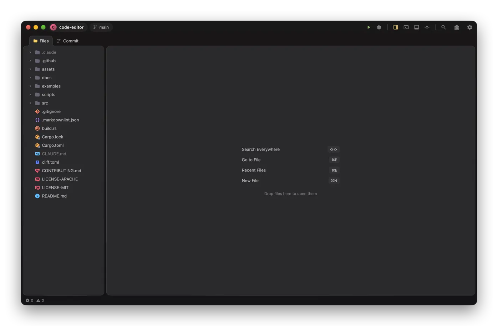

<p align="center">
  
</p>

# Kuana

**A fast, beautiful code editor, written in Rust and drawn by your GPU.**
JetBrains-style comfort, native speed, works with Zed extensions. Free and open source.

[Download](https://github.com/berkayakin/kuana-editor/releases/latest) ·
[Features](docs/features.md) ·
[Documentation](docs/README.md) ·
[Contributing](CONTRIBUTING.md)



## Why Kuana

**⚡ Fast by design.** Kuana is native Rust with no Electron and no web view. The whole interface is
drawn on the GPU with [GPUI](https://www.gpui.rs), the framework behind Zed: Metal on macOS,
DirectX on Windows. Text uses the system's own font rendering. The editor shapes and paints only
the lines on screen. Parsing, linting, Git, search and language servers all run off the main
thread, so typing never waits for them.

**🪶 Light on memory.** With this repository open (540 files) and a 4,900-line Rust file
showing, Kuana uses about **130 MB**. Language servers run as their own processes, and restored
tabs aren't read from disk until you look at them.

**🎨 Beautiful out of the box.** A calm "islands" layout: the sidebar, editors and panels float
as rounded cards. Tabs are browser-style, transitions are smooth and the chrome stays minimal.
There are **50 built-in themes**, from Ember and Catppuccin to Tokyo Night and Rosé Pine,
each previewed live as you pick it. Prefer something plainer? One setting tones down gradients,
shadows and animations.

**🧩 Zed extensions.** Kuana reads [Zed's extension format](docs/extensions.md), so Zed's language,
theme and icon-theme extensions work as they are. Install popular languages (Java, C#, Dart, Ruby,
Zig, Vue and more) from **Settings → Extensions → Available**, built ready to use by
[Kuana's extension registry](https://github.com/berkayakin/kuana-extensions). An extension's
grammars and its own code (which finds or downloads its language server) run sandboxed as
WebAssembly.

**⌨️ Feels like home.** Search Everywhere on double Shift, Find Action, ⌥↩ for context
actions: Kuana behaves like a JetBrains IDE. One click switches to the **VS Code**, **Sublime
Text** or **Zed** keymap instead, and Vim mode is built in.

**🔋 Batteries included.** Language servers, a debugger, Git, a terminal, test running and
formatting work without hunting for plugins. If a language server is missing, the status bar
installs it with one click.

**🔒 Yours.** No account, no telemetry. Folders you haven't trusted open in
[Restricted Mode](docs/settings.md#project-trust), so cloned code can't run on its own.
Updates are signed.

## What's inside

| | |
| --- | --- |
| **Code intelligence** | Completion, hover docs, Go to Declaration / Implementation, Find Usages and Call / Type Hierarchy in a Find panel, Rename, quick fixes, inlay hints and code lenses through [language servers](docs/languages.md), imports updated when you move files; tree-sitter highlighting for 13 languages built in, any other through extensions |
| **Editing** | Multi-cursor, syntax-aware Extend Selection, column selection, folding, sticky scroll, breadcrumbs, snippets (VS Code format), [Vim mode](docs/editing.md#vim-mode), Markdown preview |
| **Git** | Gutter changes with inline diffs, staging single changes, side-by-side diffs with word highlights, a commit graph with commit actions (cherry-pick, revert, reset, tag), inline blame, branches, stashes, remotes, merge conflicts resolved in the editor; see [Git](docs/git.md) |
| **Run & debug** | ▶ next to every test and `main` (Rust, Go, Python, JS/TS), [test results](docs/run-and-debug.md#test-results) as a tree with ✓ / ✕ in the gutter and Rerun Failed, a [debugger](docs/run-and-debug.md#debugging) with conditional breakpoints and logpoints, errors from a run's output in Problems |
| **Terminal** | Your login shell in tabs and splits, full colors and mouse support, Find in scrollback, ⌘-click paths to open them |
| **Linting** | Built-in rules for JavaScript/TypeScript (oxc), HTML and Markdown, syntax errors for the rest, plus your project's ESLint |
| **Projects** | Multiple windows, hot exit (unsaved edits survive a quit), [Local History](docs/editing.md#local-history) of every file, shared [project settings](docs/settings.md#project-settings), live file watching, file operations you can undo, image preview, any text encoding |

There's much more: see the [full feature list](docs/features.md).

## Get started

**On macOS or Linux**, install the latest release with one line:

```bash
curl -fsSL https://raw.githubusercontent.com/berkayakin/kuana-editor/main/install.sh | sh
```

**Or download it** for macOS, Windows or Linux from
[GitHub Releases](https://github.com/berkayakin/kuana-editor/releases/latest). Either way, it
updates itself from then on.

| Platform | Status |
| --- | --- |
| **macOS** (Apple silicon, Intel) | Used every day; the most complete |
| **Windows** (x64, Arm64) | **Beta**: works, but has had little daily use so far |
| **Linux** (x64, Arm64) | **Beta**: as Windows; a `.tar.gz` only, no packages yet |

**Or build it** (Rust 1.94+ and `cmake`):

```bash
git clone https://github.com/berkayakin/kuana-editor.git
cd kuana-editor
cargo run --release -- path/to/project
```

See [Installing and building](docs/install.md) for details. Kuana is young: before switching,
read what it [doesn't do yet](#known-limitations).

## Documentation

| | |
| --- | --- |
| [Features](docs/features.md) | Everything Kuana does, in one list |
| [Key bindings](docs/keybindings.md) | The keymaps and how to change shortcuts |
| [Languages](docs/languages.md) | Language servers, formatting, Python environments |
| [Editing, panes and windows](docs/editing.md) | Splits, tabs, Vim mode, snippets, projects |
| [Terminal, run and debug](docs/run-and-debug.md) | Terminal, running tests, the debugger |
| [Git](docs/git.md) | Everything Git |
| [Extensions](docs/extensions.md) | Installing and writing extensions |
| [Themes](docs/themes.md) | Built-in themes and making your own |
| [Settings](docs/settings.md) | Every option, `.editorconfig`, project trust |
| [Roadmap](docs/roadmap.md) | What's planned, and what isn't there yet |

## Known limitations

Kuana is at 0.1. What people most often expect that isn't there yet (the [roadmap](docs/roadmap.md)
says what's planned):

- **Builds aren't signed yet**: on macOS, a copy downloaded with a browser asks you to allow its
  first launch ([how](docs/install.md#first-launch-on-macos); the install script above doesn't),
  and Windows SmartScreen warns. Updates are signed.
- **Windows and Linux are in beta**, see above. No Linux packages (AppImage, `.deb`, Flatpak) yet.
- **No remote development**: no SSH, dev containers or WSL folders. One folder per window (no
  multi-root workspaces).
- **No built-in AI features** (inline completion, chat).
- **Languages**: 13 have highlighting built in; others come from [extensions](docs/extensions.md),
  but there's none yet for C/C++, Kotlin or Swift.
- **Editing**: no semantic highlighting from language servers, no Emmet, no spell checking;
  ESLint runs on open and save, not as you type.
- **Git**: no three-way merge editor (conflicts are resolved in the editor), no interactive
  rebase; the log shows the latest 3,000 commits.
- **Debugger**: no hit counts or exception breakpoint options. **Vim mode**: no registers other
  than the clipboard, macros, marks or `:s`.
- **Accessibility**: screen readers can't read Kuana yet (a limit of the GPUI framework it's built on).
- No settings sync, no localization (English only).

## Contributing

Kuana is young, and contributions of every size are welcome: bug reports, themes, docs, language
support, features. Good places to start:

- **Try it and report what breaks**, especially on Windows and Linux.
- **Make a theme or an extension.** Neither needs any Rust: see [Themes](docs/themes.md) and
  [Extensions](docs/extensions.md).
- **Pick an open [issue](https://github.com/berkayakin/kuana-editor/issues)**, or take something
  from the [roadmap](docs/roadmap.md): a three-way merge editor, Vim registers and macros, semantic
  tokens, a C/C++ extension.

The [contributing guide](CONTRIBUTING.md) covers building, the checks a change has to pass and
the conventions the code follows; [Architecture](docs/architecture.md) maps the code.

## License

Licensed under either of

- Apache License, Version 2.0 ([LICENSE-APACHE](LICENSE-APACHE) or <https://www.apache.org/licenses/LICENSE-2.0>)
- MIT license ([LICENSE-MIT](LICENSE-MIT) or <https://opensource.org/licenses/MIT>)

at your option.

Unless you explicitly state otherwise, any contribution intentionally submitted
for inclusion in the work by you, as defined in the Apache-2.0 license, shall be
dual licensed as above, without any additional terms or conditions.

Bundled third-party assets keep their own licenses: file-type icons from
[Charmed Icons](https://github.com/littensy/charmed-icons) by littensy and jmesrje (MIT,
[`assets/file-icons/LICENSE`](assets/file-icons/LICENSE)), the Vidaloka font (SIL Open Font
License, [`assets/fonts/OFL.txt`](assets/fonts/OFL.txt)) and the ported color themes (MIT, each
author credited in [`assets/themes/LICENSE`](assets/themes/LICENSE)).

Zed, JetBrains, Visual Studio Code and Sublime Text are trademarks of their respective owners.
Kuana is an independent project, not affiliated with or endorsed by any of them; it mentions them
only to describe compatibility.
