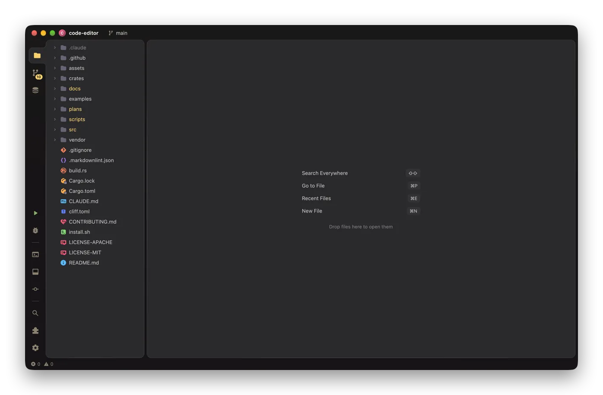
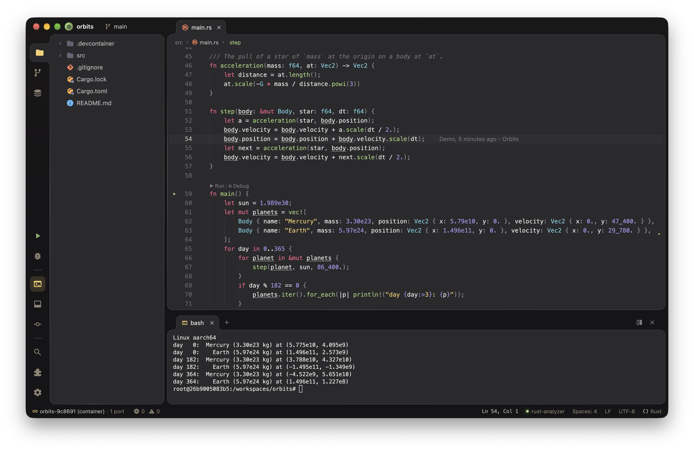

<p align="center">
  
</p>

# Kuana

**A fast, beautiful code editor, written in Rust and drawn by your GPU.**
JetBrains-style comfort with native speed: language servers, a debugger, Git, a Test Explorer,
databases and remote development over SSH, WSL and containers, all built in. Works with Zed
extensions. Free and open source.

[Download](https://github.com/berkayakin/kuana-editor/releases/latest) ·
[Features](docs/features.md) ·
[Documentation](docs/README.md) ·
[Contributing](CONTRIBUTING.md)



## Why Kuana

**⚡ Fast by design.** Kuana is native Rust with no Electron and no web view. The whole interface is
drawn on the GPU with [GPUI](https://www.gpui.rs), the framework behind Zed: Metal on macOS,
DirectX on Windows. Text uses the system's own font rendering. The editor shapes and paints only
the lines on screen. Parsing, linting, Git, search and language servers all run off the main
thread, so typing never waits for them. A window that isn't changing draws nothing and wakes nothing,
so an idle Kuana leaves your battery alone.

**🏁 Faster and lighter than Zed.** Side by side with Zed, which is built on the same GPU framework,
Kuana opens sooner and uses less memory, fewer threads and less CPU at rest:

| With this repository open and an 8,000-line Rust file showing | Kuana | Zed 1.28 |
| --- | --- | --- |
| Launch to window on screen (median of 15) | **327 ms** | 403 ms |
| Memory (as Activity Monitor counts it) | **144 MB** | 159 MB |
| Resident memory | **168 MB** | 228 MB |
| Threads | **10** | 26 |
| CPU while idle | **0.1–0.2 %** | 0.2–0.3 % |

<sup>Measured in November 2026 on a MacBook Pro (M1 Pro, 16 GB), macOS 27. Each editor had a fresh configuration
with its language servers off, and the two launched alternately. Memory was read 10 seconds after the window
appeared; idle CPU is the average over 2½ minutes, after a minute's rest.</sup>

**🪶 Light on memory.** Language servers run as their own processes, and restored tabs aren't read
from disk until you look at them.

**🎨 Beautiful out of the box.** A calm "islands" layout: the sidebar, editors and panels float
as rounded cards. Tabs are browser-style, transitions are smooth and the chrome stays minimal.
There are **50 built-in themes**, from Ember and Catppuccin to Tokyo Night and Rosé Pine,
each previewed live as you pick it. Arrange it your way: a Classic layout of square panels, the
tool buttons on an activity bar (full or compact) or in a title bar, the sidebar on either side
and a second sidebar beside the editor, and Zen mode when you only want the text. Prefer
something plainer? One setting tones down gradients, shadows and animations.

**🧩 Zed extensions.** Kuana reads [Zed's extension format](docs/extensions.md), so Zed's language,
theme and icon-theme extensions work as they are. Install popular languages (C and C++, Java, Kotlin, Swift, C#,
Dart, Ruby, Zig, Vue and over 40 more) and Emmet from **Settings → Extensions → Available**, built ready to use by
[Kuana's extension registry](https://github.com/berkayakin/kuana-extensions). An extension's
grammars and its own code (which finds or downloads its language server) run sandboxed as
WebAssembly.

**⌨️ Feels like home.** Search Everywhere on double Shift, Find Action, ⌥↩ for context
actions: Kuana behaves like a JetBrains IDE. One click switches to the **VS Code**, **Sublime
Text** or **Zed** keymap instead, and Vim mode is built in. Coming from VS Code or a JetBrains
IDE? [Import Settings](docs/settings.md#importing-from-vs-code-or-jetbrains) brings your
settings, shortcuts, snippets and language extensions along.

**🔋 Batteries included.** Language servers, a debugger, Git, a terminal, test running and
formatting work without hunting for plugins. If a language server is missing, the status bar
installs it with one click.

**🌐 Remote development, built in.** Open a project on another machine [over SSH](docs/remote.md),
in WSL or inside a container, [dev containers](docs/remote.md#containers) included, with no
extension to install. The window and everything you type stay on your computer, so typing never
waits on the network, while a small server Kuana copies over does the work there: files, search,
Git, language servers, terminals, tests and the debugger all run on that machine with its own
tools. It uses your own `ssh`, config and keys, forwards ports to your browser and reconnects by
itself when the connection drops.



**🔒 Yours.** No account, no telemetry. Folders you haven't trusted open in
[Restricted Mode](docs/settings.md#project-trust), so cloned code can't run on its own.
Updates are signed.

## What's inside

| | |
| --- | --- |
| **Code intelligence** | Completion, hover docs, Go to Declaration / Implementation, Find Usages and Call / Type Hierarchy in a Find panel, Rename, quick fixes, inlay hints, code lenses and [semantic highlighting](docs/editing.md#semantic-highlighting) through [language servers](docs/languages.md), imports updated when you move files; tree-sitter highlighting for 13 languages built in, any other through extensions |
| **Editing** | Multi-cursor, syntax-aware Extend Selection, column selection, folding, sticky scroll, breadcrumbs, [Back and Forward](docs/editing.md#back-and-forward), snippets (VS Code format) and [postfix completion](docs/editing.md#postfix-completion), [multibuffers](docs/editing.md#multibuffers) (search results and problems from many files, edited in one tab), [color swatches and a picker](docs/editing.md#colors), [linked editing](docs/editing.md#linked-editing) of tag names, [Vim mode](docs/editing.md#vim-mode), Markdown preview, [Zen mode](docs/editing.md#zen-mode), [compare anything](docs/editing.md#comparing-files) (the clipboard, another file, a branch), [scratch files](docs/editing.md#scratch-files), GitHub Copilot's suggestions as [ghost text](docs/editing.md#edit-predictions) (off until you turn them on), [Claude Code](docs/editing.md#claude-code) seeing your selection and proposing edits as diffs |
| **AI** | [Agent sessions](docs/ai.md#agent-sessions) in tabs beside your code, with Kuana's own agent or Claude, Codex, Gemini CLI, GitHub Copilot and more: every step shown with its diff or output, permissions asked, changes reviewed and undone; [Inline Assist](docs/ai.md#inline-assist) on a selection, commit messages, merge conflicts and [MCP servers](docs/ai.md#mcp-servers), on Anthropic, OpenAI, Ollama and other providers; off until you choose |
| **Git** | Gutter changes with inline diffs, staging single changes, side-by-side diffs with word highlights, a commit graph with commit actions (cherry-pick, revert, reset, tag), inline blame, branches, stashes, remotes, merge conflicts resolved in the editor; see [Git](docs/git.md) |
| **Run & debug** | ▶ next to every test and `main` (Rust, Go, Python, JS/TS), a [Test Explorer](docs/run-and-debug.md#test-explorer) with every test before it runs, [test results](docs/run-and-debug.md#test-results) as a tree with ✓ / ✕ in the gutter and Rerun Failed, a [debugger](docs/run-and-debug.md#debugging) with conditional breakpoints, logpoints, values inline in the code while paused and on hover, errors from a run's output in Problems |
| **Databases** | A [Database](docs/database.md) view for PostgreSQL, MySQL, MariaDB, SQLite and Oracle: browse tables, views, functions and procedures, edit and save routines with errors in place, run SQL with results in a grid; drivers built in |
| **Terminal** | Your login shell in tabs and splits, full colors and mouse support, Find in scrollback, ⌘-click paths to open them, [shell integration](docs/editing.md#terminal-shell-integration): each command marked, jump between them, copy one's output |
| **Remote** | Projects on [SSH hosts](docs/remote.md) from your `~/.ssh/config`, in WSL and in running containers or [dev containers](docs/remote.md#containers) (`devcontainer.json`), with the language servers, terminals, Run, debugger and Git of that machine; forwarded ports, reconnecting by itself |
| **Linting** | Built-in rules for JavaScript/TypeScript (oxc), HTML and Markdown, syntax errors for the rest, plus your project's ESLint as you type, with its quick fixes |
| **Projects** | [Several folders in one window](docs/editing.md#several-folders-in-one-window), each with its own Git repository, language servers and settings; multiple windows, hot exit (unsaved edits survive a quit), [Local History](docs/editing.md#local-history) of every file, shared [project settings](docs/settings.md#project-settings), live file watching, file operations you can undo, image preview, any text encoding |

There's much more: see the [full feature list](docs/features.md).

## Get started

**On macOS or Linux**, install the latest release with one line:

```bash
curl -fsSL https://raw.githubusercontent.com/berkayakin/kuana-editor/main/install.sh | sh
```

**With Homebrew** on macOS:

```bash
brew install --cask berkayakin/tap/kuana
```

**Or download it** for macOS, Windows or Linux from
[GitHub Releases](https://github.com/berkayakin/kuana-editor/releases/latest). Whichever way, it
updates itself from then on.

| Platform | Status |
| --- | --- |
| **macOS** (Apple silicon, Intel) | Used every day; the most complete |
| **Windows** (x64, Arm64) | Stable: tested across its main areas |
| **Linux** (x64, Arm64) | **Beta**: works, but has had little testing so far; a `.tar.gz` only, no packages yet |

**Or build it** (Rust 1.94+ and `cmake`):

```bash
git clone https://github.com/berkayakin/kuana-editor.git
cd kuana-editor
cargo run --release -- path/to/project
```

See [Installing and building](docs/install.md) for details. Kuana is young: before switching,
read what it [doesn't do yet](#known-limitations).

## Documentation

| | |
| --- | --- |
| [Features](docs/features.md) | Everything Kuana does, in one list |
| [Key bindings](docs/keybindings.md) | The keymaps and how to change shortcuts |
| [Languages](docs/languages.md) | Language servers, formatting, Python environments |
| [Editing, panes and windows](docs/editing.md) | Splits, tabs, Vim mode, snippets, Copilot's suggestions, Claude Code, projects |
| [AI](docs/ai.md) | Agent sessions, Inline Assist, commit messages, conflicts, MCP servers |
| [Terminal, run and debug](docs/run-and-debug.md) | Terminal, running tests, the debugger |
| [Remote development](docs/remote.md) | Projects over SSH, in WSL and in containers, ports, reconnecting |
| [Git](docs/git.md) | Everything Git |
| [Databases](docs/database.md) | PostgreSQL, MySQL/MariaDB, SQLite and Oracle connections, browsing, editing objects, running SQL |
| [Extensions](docs/extensions.md) | Installing and writing extensions |
| [Writing view extensions](docs/extension-ui.md) | Views, commands and panels of your own |
| [Themes](docs/themes.md) | Built-in themes and making your own |
| [Settings](docs/settings.md) | Every option, `.editorconfig`, project trust |
| [Roadmap](docs/roadmap.md) | What's planned, and what isn't there yet |

## Known limitations

Kuana is young. What people most often expect that isn't there yet (the [roadmap](docs/roadmap.md)
says what's planned):

- **Builds aren't signed yet**: on macOS, a copy downloaded with a browser or Homebrew asks you to allow its
  first launch ([how](docs/install.md#first-launch-on-macos); the install script above doesn't),
  and Windows SmartScreen warns. Updates are signed.
- **Linux is in beta**, see above. No Linux packages (AppImage, `.deb`, Flatpak) yet.
- **Remote development is new**: the other machine must run Linux or macOS (a Windows PC is
  reached through WSL), and language servers it lacks are installed there by hand, not with
  Kuana's one-click install.
- **AI is new**: [agent sessions](docs/ai.md) work in local projects only (in a remote one, run an
  agent in Kuana's terminal there), and edit predictions come from GitHub Copilot only.
- **Languages**: 13 are built in; the rest, C/C++, Kotlin and Swift included, are
  [extensions](docs/extensions.md) from Kuana's registry, installed with one click.
- **Editing**: no spell checking.
- **Git**: commits can be reworded, squashed and dropped, not reordered or split; the log shows
  the latest 3,000 commits.
- **Debugger**: no hit counts or exception breakpoint options. **Vim mode**: no registers other
  than the clipboard, macros, marks or `:s`.
- **Accessibility**: screen readers can't read Kuana yet (a limit of the GPUI framework it's built on).
- No settings sync, no localization (English only).

## Contributing

Kuana is young, and contributions of every size are welcome: bug reports, themes, docs, language
support, features. Good places to start:

- **Try it and report what breaks**, especially on Linux.
- **Make a theme or an extension.** Neither needs any Rust: see [Themes](docs/themes.md) and
  [Extensions](docs/extensions.md).
- **Pick an open [issue](https://github.com/berkayakin/kuana-editor/issues)**, or take something
  from the [roadmap](docs/roadmap.md): reordering commits, Vim registers and macros, spell checking, Linux
  packages.

The [contributing guide](CONTRIBUTING.md) covers building, the checks a change has to pass and
the conventions the code follows; [Architecture](docs/architecture.md) maps the code.

## License

Licensed under either of

- Apache License, Version 2.0 ([LICENSE-APACHE](LICENSE-APACHE) or <https://www.apache.org/licenses/LICENSE-2.0>)
- MIT license ([LICENSE-MIT](LICENSE-MIT) or <https://opensource.org/licenses/MIT>)

at your option.

Unless you explicitly state otherwise, any contribution intentionally submitted
for inclusion in the work by you, as defined in the Apache-2.0 license, shall be
dual licensed as above, without any additional terms or conditions.

Bundled third-party assets keep their own licenses: file-type icons from
[Charmed Icons](https://github.com/littensy/charmed-icons) by littensy and jmesrje (MIT,
[`assets/file-icons/LICENSE`](assets/file-icons/LICENSE)), the Vidaloka font (SIL Open Font
License, [`assets/fonts/OFL.txt`](assets/fonts/OFL.txt)), the JetBrains Mono font (SIL Open Font
License, [`assets/fonts/JetBrainsMono-OFL.txt`](assets/fonts/JetBrainsMono-OFL.txt)) and the ported color themes (MIT, each
author credited in [`assets/themes/LICENSE`](assets/themes/LICENSE)).

Zed, JetBrains, Visual Studio Code and Sublime Text are trademarks of their respective owners.
Kuana is an independent project, not affiliated with or endorsed by any of them; it mentions them
only to describe compatibility.
